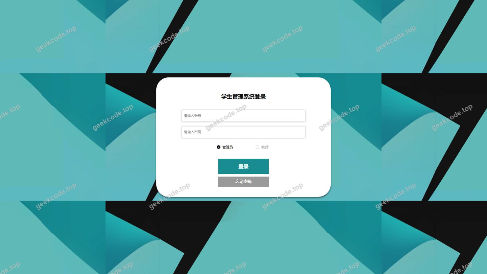
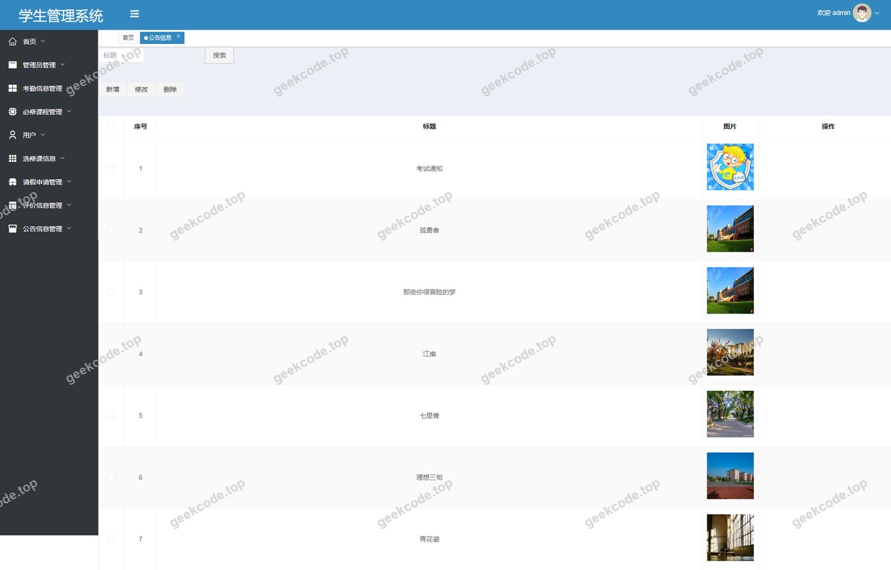
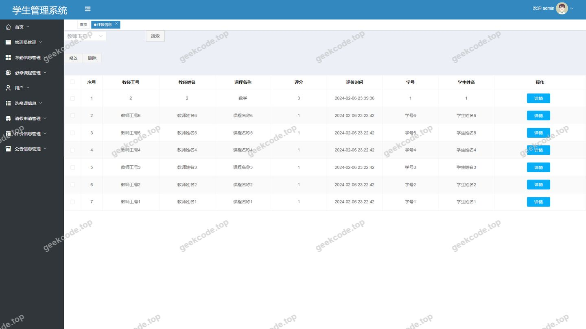
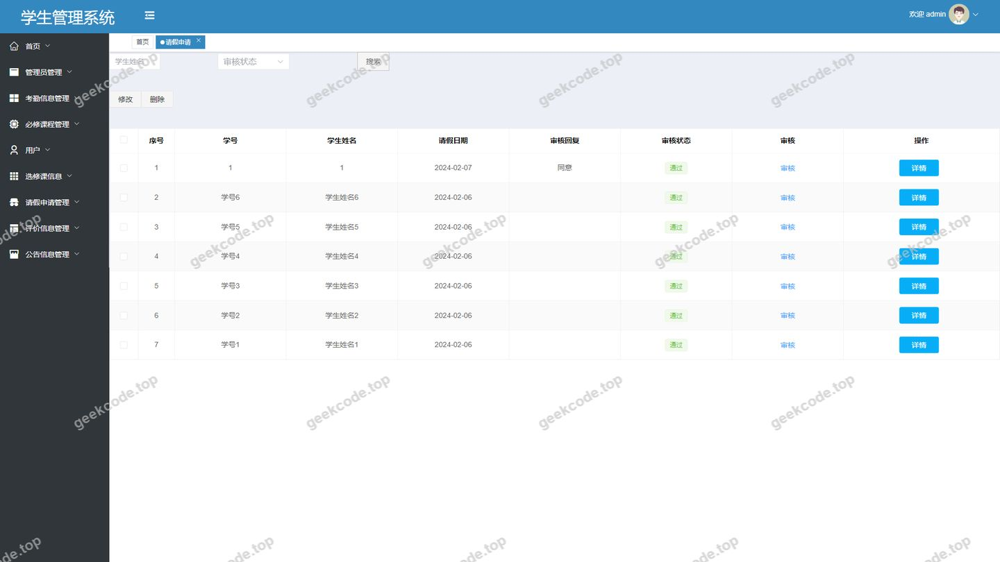
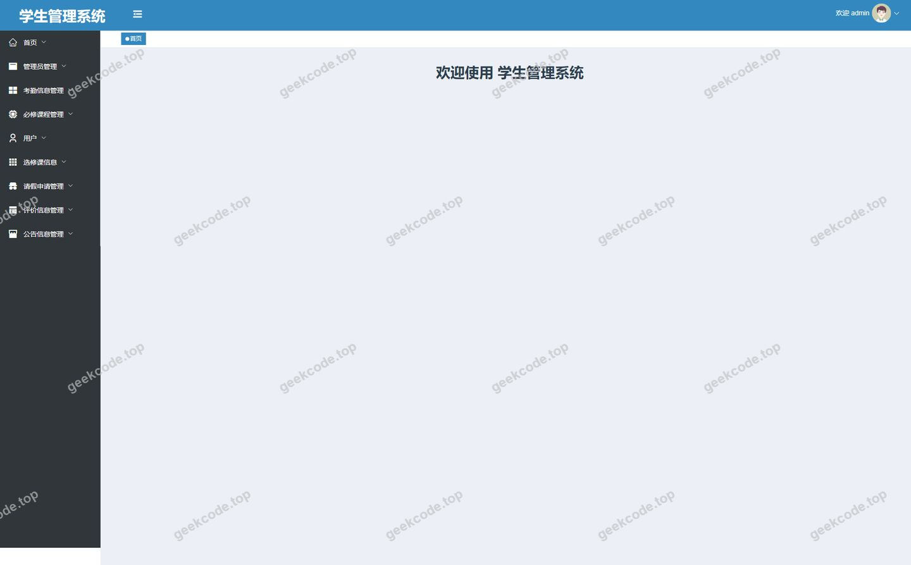
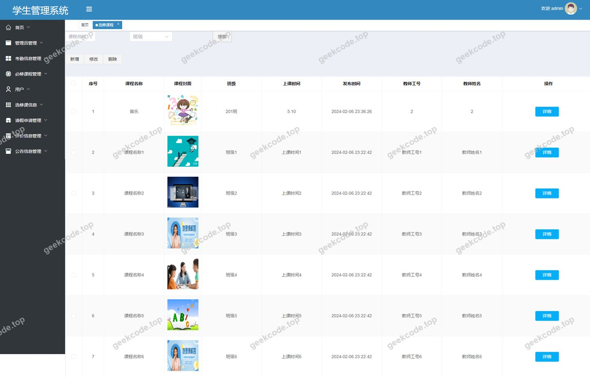
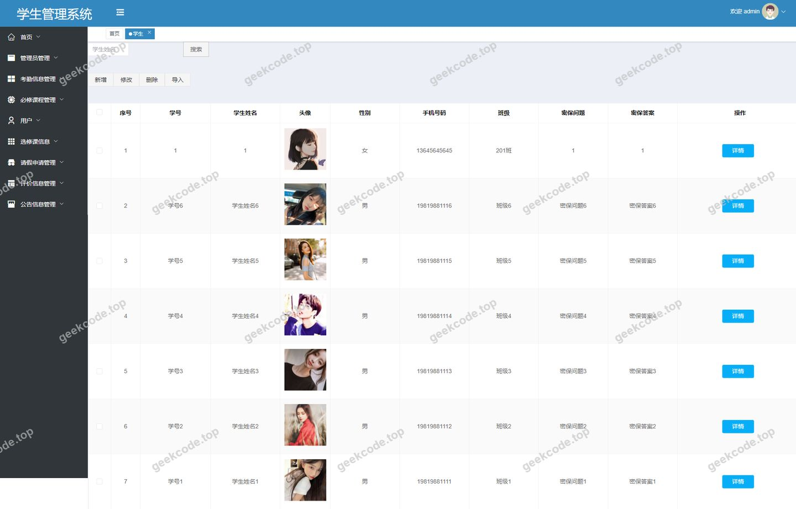
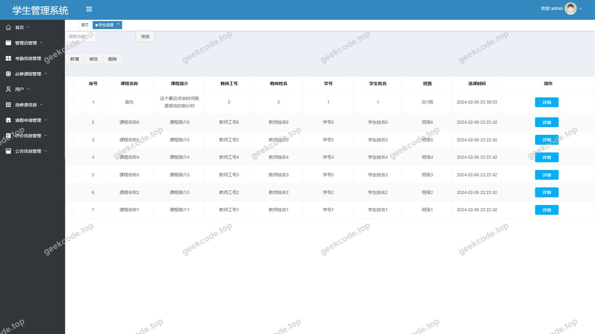

# springboot + vue 学生管理系统

> 🎓 **计算机毕业设计 · springboot + vue 学生管理系统**
>
> 本仓库只放**项目介绍 + 运行截图**（截图是站点带水印的原图，存在仓库 `images/` 里）。
>
> 👉 **完整可运行源码 / 数据库脚本 / 部署文档：[点我获取](https://geekcode.top/archives/springboot-vue-%E5%AD%A6%E7%94%9F%E7%AE%A1%E7%90%86%E7%B3%BB%E7%BB%9F?utm_source=github)**
>
> 💬 咨询微信：**ir9372**　|　🌐 更多项目：[极客代码 geekcode.top](https://geekcode.top/?utm_source=github)
>
> 📌 项目详情页：<https://geekcode.top/archives/springboot-vue-%E5%AD%A6%E7%94%9F%E7%AE%A1%E7%90%86%E7%B3%BB%E7%BB%9F?utm_source=github>

<table><td width="230" align="center"> <b>扫码加微信 ir9372</b></td><td valign="middle">📦 源码 = 项目介绍 + 全部运行截图 + 数据库 + 部署文档 👉 点上方任意截图，直接跳到 <b>极客代码 geekcode.top</b> 详情页</td></table>

---

<h1>springboot + vue 学生管理系统</h1>
<h2>项目概述</h2>

本项目为基于 Spring Boot 与 Vue 技术栈构建的学生管理系统，采用前后端分离架构。系统旨在实现高校教学管理流程的数字化，核心功能涵盖学生信息管理、教师信息维护、课程管理（包括选修课与必修课）、选课业务处理、考勤记录、请假申请审批以及教学质量评价（评教）等模块。适用人群主要为学校教务管理人员、教师及学生群体。通过该系统，管理员可高效维护基础数据并审核业务流程，教师可查看相关教学安排与学生反馈，学生则能完成选课、请假及查看个人状态等操作。技术架构上，后端依托 Spring Boot 提供 RESTful API，集成 MyBatis-Plus 进行持久层操作，使用 Shiro 框架保障系统安全与权限控制；前端采用 Vue.js 框架构建用户界面，实现了良好的交互体验与模块化开发结构。

<h2>技术架构</h2>

本系统采用经典的前后端分离模式，确保系统的高内聚低耦合，便于后续维护与扩展。

<strong>1. 后端架构</strong>
后端服务基于 Java 语言开发，核心框架选用 <strong>Spring Boot</strong>。利用其自动配置特性简化部署流程，并通过 <code>spring-boot-starter-web</code> 快速构建 Web 应用接口。

<ul>
<li><strong>持久层</strong>：采用 <strong>MyBatis-Plus</strong> 作为 ORM 框架，结合 <code>mybatis-spring-boot-starter</code> 和 <code>mysql-connector-java</code> 驱动连接 MySQL 数据库。MyBatis-Plus 提供了通用的 CRUD 方法，显著减少了重复 SQL 代码的编写，提升了开发效率。</li>
<li><strong>安全框架</strong>：集成 <strong>Apache Shiro</strong> (<code>shiro-spring</code>) 进行身份认证与授权管理。Shiro 负责处理用户登录状态维持、角色权限校验及会话管理，确保只有具备相应权限的用户才能访问特定资源。</li>
<li><strong>其他依赖</strong>：引入 <code>commons-lang3</code> 用于工具类支持，<code>validation-api</code> 用于参数合法性校验，<code>protobuf-java</code> 可能用于特定数据序列化场景。</li>
</ul>

<strong>2. 前端架构</strong>
前端基于 <strong>Vue.js</strong> 生态构建。根据路由配置分析，系统划分为前台展示端与后台管理端。

<ul>
<li><strong>视图渲染</strong>：利用 Vue 组件化思想，将页面拆分为列表页（List）、详情页（Detail）和添加/编辑页（Add）。</li>
<li><strong>路由管理</strong>：通过 Vue Router 管理页面跳转，后台路由包含 <code>/jiaoshiCenter</code>, <code>/xueshengxuanke</code> 等业务模块，前台路由包含 <code>/index/xueshengList</code>, <code>/index/newsList</code> 等公开或半公开页面。</li>
<li><strong>交互逻辑</strong>：前端通过 Axios 或其他 HTTP 客户端向后端发起请求，获取 JSON 格式数据进行动态渲染。</li>
</ul>

<strong>3. 数据库设计要点</strong>
数据存储于 <strong>MySQL</strong> 关系型数据库中。根据功能模块推断，主要数据表应包含：

<ul>
<li><strong>基础信息表</strong>：存储管理员（users）、学生（xuesheng）、教师（jiaoshi）的基本档案。</li>
<li><strong>课程与班级表</strong>：存储选修课程（xuanxiukecheng）、必修课程（bixiukecheng）及其对应的班级（banji）关联信息。</li>
<li><strong>业务流水表</strong>：记录选课结果（xueshengxuanke）、考勤信息（kaoqinxinxi）、请假申请（qingjiashenqing）及评教信息（pingjiaoxinxi）。</li>
<li><strong>内容管理表</strong>：存储公告新闻（news）及收藏记录（storeup）。</li>
</ul>
<h2>功能模块</h2>

系统功能依据用户视角划分为前台用户端与后台管理端两大板块。

<h3>1. 后台管理端</h3>

后台面向管理员及特定权限用户，提供全面的数据管理与业务审核功能。

<ul>
<li><strong>用户与权限管理</strong>：</li>
<li><strong>管理员账户</strong>：通过 <code>/users</code> 路由管理超级管理员账号。</li>
<li><strong>教师中心</strong>：通过 <code>/jiaoshiCenter</code> 提供教师专属的工作台入口。</li>
<li><strong>忘记密码</strong>：提供 <code>/forget</code> 路由用于密码找回流程。</li>
<li><strong>基础数据维护</strong>：</li>
<li><strong>学生管理</strong>：通过 <code>/xuesheng</code> 路由对学生基本信息进行增删改查。</li>
<li><strong>教师管理</strong>：通过 <code>/jiaoshi</code> 路由维护教师档案信息。</li>
<li><strong>班级管理</strong>：通过 <code>/banji</code> 路由管理行政班级划分。</li>
<li><strong>课程管理</strong>：</li>
<li><strong>选修课程</strong>：通过 <code>/xuanxiukecheng</code> 管理选修课目录及详情。</li>
<li><strong>选修课集</strong>：通过 <code>/xuanxiukechengji</code> 管理选修课程的集合或分组策略。</li>
<li><strong>必修课程</strong>：通过 <code>/bixiukecheng</code> 管理必修课信息。</li>
<li><strong>必修课集</strong>：通过 <code>/bixiukechengji</code> 管理必修课的集合配置。</li>
<li><strong>业务办理与审核</strong>：</li>
<li><strong>学生选课</strong>：通过 <code>/xueshengxuanke</code> 监控和处理学生的选课记录。</li>
<li><strong>请假申请</strong>：通过 <code>/qingjiashenqing</code> 审核学生提交的请假单据。</li>
<li><strong>考勤信息</strong>：通过 <code>/kaoqinxinxi</code> 录入和查询学生的出勤状况。</li>
<li><strong>评教信息</strong>：通过 <code>/pingjiaoxinxi</code> 收集和管理学生对教师的教学评价。</li>
<li><strong>信息发布</strong>：</li>
<li><strong>公告信息</strong>：通过 <code>/news</code> 发布校园通知、教务公告等内容。</li>
</ul>
<h3>2. 前台用户端</h3>

前台主要服务于学生和教师，提供自助查询与信息提交功能。

<ul>
<li><strong>学生服务模块</strong>：</li>
<li><strong>个人信息</strong>：通过 <code>/index/xueshengCenter</code> 查看个人中心，<code>/index/xueshengDetail</code> 查看详情，<code>/index/xueshengAdd</code> 完善或修改资料。</li>
<li><strong>选课业务</strong>：通过 <code>/index/xueshengxuankeList</code> 浏览可选课程，<code>/index/xueshengxuankeAdd</code> 提交选课申请，<code>/index/xueshengxuankeDetail</code> 查看选课状态。</li>
<li><strong>请假与考勤</strong>：通过 <code>/index/kaoqinxinxiList</code> 和 <code>/index/kaoqinxinxiDetail</code> 查看个人考勤记录。</li>
<li><strong>课程查询</strong>：</li>
<li>选修课：<code>/index/xuanxiukechengList</code> 列表查看，<code>/index/xuanxiukechengDetail</code> 详情，<code>/index/xuanxiukechengAdd</code> 新增意向或收藏。</li>
<li>必修课：<code>/index/bixiukechengList</code> 列表，<code>/index/bixiukechengDetail</code> 详情，<code>/index/bixiukechengAdd</code> 相关操作。</li>
<li>课程集：<code>/index/xuanxiukechengjiList</code> 和 <code>/index/bixiukechengjiList</code> 查看分类课程包。</li>
<li><strong>教师服务模块</strong>：</li>
<li><strong>教师信息</strong>：通过 <code>/index/jiaoshiList</code> 查看教师名录，<code>/index/jiaoshiDetail</code> 查看简介，<code>/index/jiaoshiAdd</code> 更新个人资料。</li>
<li><strong>公共资讯模块</strong>：</li>
<li><strong>公告浏览</strong>：通过 <code>/index/newsList</code> 阅读最新教务通知。</li>
<li><strong>收藏功能</strong>：通过 <code>/index/storeupList</code> 查看已收藏的课程或公告。</li>
<li><strong>首页导航</strong>：通过 <code>/index/xueshengList</code> 等路由展示学生风采或相关信息列表。</li>
</ul>
<h2>用户角色与权限</h2>

根据系统路由结构与业务逻辑，主要涉及以下三类角色，各角色拥有不同的数据访问与操作权限：

<table>
<thead>
<tr>
<th align="left">角色</th>
<th align="left">描述</th>
<th align="left">可访问的功能模块/权限范围</th>
</tr>
</thead>
<tbody><tr>
<td align="left"><strong>管理员 (Admin)</strong></td>
<td align="left">系统最高权限持有者，负责全局配置与数据监管。</td>
<td align="left"><strong>全部后台功能</strong>：1. <strong>基础数据</strong>：完全管理学生(<code>/xuesheng</code>)、教师(<code>/jiaoshi</code>)、班级(<code>/banji</code>)、管理员(<code>/users</code>)。2. <strong>课程配置</strong>：管理所有选修/必修课程及其集合(<code>/xuanxiukecheng</code>, <code>/bixiukecheng</code> 等)。3. <strong>业务审核</strong>：审核请假(<code>/qingjiashenqing</code>)、处理选课冲突或记录(<code>/xueshengxuanke</code>)、录入考勤(<code>/kaoqinxinxi</code>)、查看评教汇总(<code>/pingjiaoxinxi</code>)。4. <strong>内容发布</strong>：发布公告(<code>/news</code>)。5. <strong>系统设置</strong>：处理密码重置(<code>/forget</code>)及进入教师中心(<code>/jiaoshiCenter</code>)进行代管或查看。</td>
</tr>
<tr>
<td align="left"><strong>教师 (Jiaoshi)</strong></td>
<td align="left">教学执行者，关注自身授课信息及学生反馈。</td>
<td align="left"><strong>部分后台/前台功能</strong>：1. <strong>个人中心</strong>：访问 <code>/jiaoshiCenter</code>，查看和编辑个人档案(<code>/index/jiaoshiDetail</code>, <code>/index/jiaoshiAdd</code>)。2. <strong>评教查看</strong>：在后台或通过特定入口查看针对自己的评教信息(<code>/pingjiaoxinxi</code>)。3. <strong>课程相关</strong>：查看所授课程的选课情况(<code>/xueshengxuanke</code>)及学生名单。4. <strong>公告接收</strong>：在前台查看 <code>/index/newsList</code>。</td>
</tr>
<tr>
<td align="left"><strong>学生 (Xuesheng)</strong></td>
<td align="left">受教育者，主要进行自助式业务办理。</td>
<td align="left"><strong>前台自助服务</strong>：1. <strong>学籍管理</strong>：查看和更新个人信息(<code>/index/xueshengCenter</code>, <code>/index/xueshengDetail</code>)。2. <strong>选课操作</strong>：浏览课程列表(<code>/index/xuanxiukechengList</code>, <code>/index/bixiukechengList</code>)，提交选课申请(<code>/index/xueshengxuankeAdd</code>)，查看选课结果(<code>/index/xueshengxuankeDetail</code>)。3. <strong>事务申请</strong>：提交请假申请（对应后台 <code>/qingjiashenqing</code> 的流程发起），查看个人考勤(<code>/index/kaoqinxinxiList</code>)。4. <strong>信息查阅</strong>：浏览公告(<code>/index/newsList</code>)，查看教师介绍(<code>/index/jiaoshiList</code>)，管理个人收藏(<code>/index/storeupList</code>)。</td>
</tr>
</tbody></table>

<em>注：具体按钮级权限（如“删除”、“编辑”）由 Shiro 框架在后端接口层面进行细粒度控制，上述表格列出了角色可触达的核心业务模块。</em>

<h2>项目特色与创新点</h2>
<ol>
<li>
<strong>完善的闭环业务流程</strong>：
   系统不仅涵盖了静态的基础数据管理（学生、教师、课程），更打通了动态的业务流程，特别是“选课-审核-考勤-请假-评教”这一完整链条。例如，学生通过前台发起选课和请假，管理员在后台进行审核，最终形成考勤和评教数据，实现了教务管理的自动化闭环。

</li>
<li>
<strong>精细化的课程管理体系</strong>：
   区别于简单的课程列表，系统设计了“选修/必修”双轨制，并引入了“课程集”（<code>xuanxiukechengji</code>, <code>bixiukechengji</code>）概念。这种设计允许管理员对课程进行打包分类或设置特定的选课规则，满足了高校复杂的学分制管理需求。

</li>
<li>
<strong>前后端分离的安全架构</strong>：
   采用 Spring Boot + Shiro + MyBatis-Plus 的后端组合，确保了数据访问的高效性与安全性。Shiro 的集成使得权限控制可以精确到 URL 级别（如区分 <code>/admin</code> 与 <code>/index</code> 路径下的不同操作），有效防止越权访问。前端 Vue 的组件化复用（如统一的 List/Detail/Add 模板结构）提高了开发一致性。

</li>
<li>
<strong>多维度的信息交互</strong>：
   系统支持“评教信息”模块，打破了传统教务系统单向发布的局限，建立了学生向教师反馈的双向沟通渠道。同时，“收藏”功能（<code>storeup</code>）增强了用户对感兴趣课程或公告的个性化留存能力。

</li>
</ol>
<h2>部署环境</h2>

为确保系统正常运行，需准备以下软硬件环境：

<strong>1. 硬件要求</strong>

<ul>
<li>CPU: Intel Core i5 及以上或同等性能处理器</li>
<li>内存: 8GB RAM 及以上（建议 16GB 以优化编译速度）</li>
<li>硬盘: SSD 固态硬盘，剩余空间至少 20GB</li>
</ul>

<strong>2. 软件环境</strong>

<ul>
<li><strong>操作系统</strong>: Windows 10/11, macOS, 或 Linux (CentOS/Ubuntu)</li>
<li><strong>Java 运行环境</strong>: JDK 1.8 或更高版本（推荐 JDK 8 LTS）</li>
<li><strong>数据库</strong>: MySQL 5.7 或 MySQL 8.0</li>
<li>需安装 MySQL Server 并配置远程访问权限</li>
<li>创建专用数据库实例用于存储业务数据</li>
<li><strong>构建工具</strong>: Maven 3.6+</li>
<li>用于管理 Spring Boot 项目的依赖库（如 <code>spring-boot-starter-web</code>, <code>mybatis-plus</code> 等）</li>
<li><strong>Node.js 环境</strong>: Node.js v14.x 或 v16.x</li>
<li>包含 npm 或 yarn 包管理器</li>
<li>用于编译和运行 Vue 前端项目</li>
<li><strong>Web 服务器</strong>: </li>
<li>开发阶段：内置 Tomcat (Spring Boot 自带) + Vue DevServer</li>
<li>生产阶段：Nginx (用于反向代理前端静态资源及后端 API)</li>
</ul>

<strong>3. 开发工具</strong>

<ul>
<li>IDE: IntelliJ IDEA 或 Eclipse (后端), VS Code 或 WebStorm (前端)</li>
<li>数据库管理工具: Navicat Premium 或 DBeaver</li>
</ul>
<h2>五、技术特性</h2>
<ul>
<li>前后端分离架构，前端独立部署</li>
<li>使用 MyBatis-Plus 简化数据访问层开发</li>
<li>集成 Shiro 权限框架实现角色权限控制</li>
</ul>
<h2>六、功能模块截图</h2>
<h3>后台管理端</h3>
<h4>后台-登录页</h4>

<h4>后台-公告信息</h4>

<h4>后台-评教信息</h4>

<h4>后台-请假申请</h4>

<h4>页面-首页</h4>

<h4>后台-选修课程</h4>

<h4>后台-学生</h4>

<h4>后台-学生选课</h4>

---

## 获取完整源码

| 项目 | 说明 |
| --- | --- |
| 项目名 | springboot + vue 学生管理系统 |
| 运行截图 | 本文 8 张（站点带水印原图，仓库 `images/` 目录） |
| 完整源码 | [https://geekcode.top/archives/springboot-vue-%E5%AD%A6%E7%94%9F%E7%AE%A1%E7%90%86%E7%B3%BB%E7%BB%9F?utm_source=github](https://geekcode.top/archives/springboot-vue-%E5%AD%A6%E7%94%9F%E7%AE%A1%E7%90%86%E7%B3%BB%E7%BB%9F?utm_source=github) |
| 咨询微信 | **ir9372**（备注：jingpin-yuanma） |
| 更多项目 | [极客代码 geekcode.top](https://geekcode.top/?utm_source=github) |

> 需要源码、部署、改配置、跑不起来等问题，加微信 ir9372 沟通，说明项目名即可。
